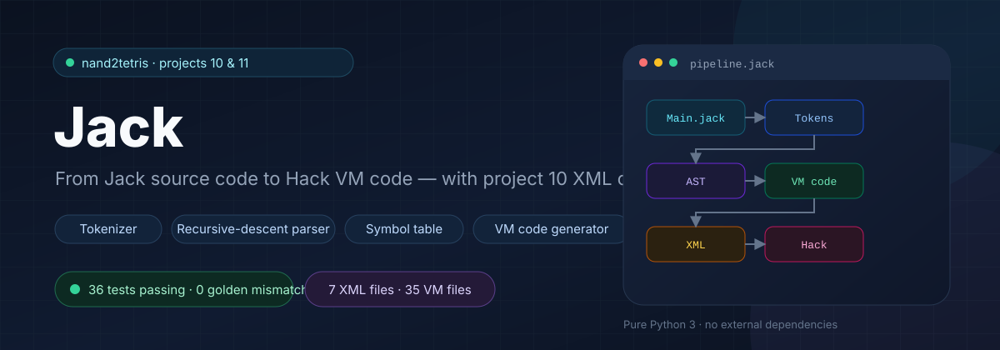
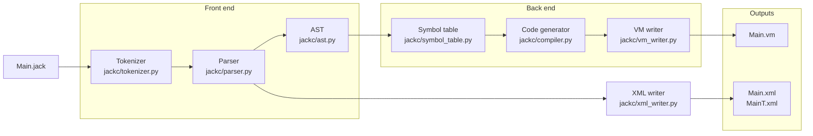
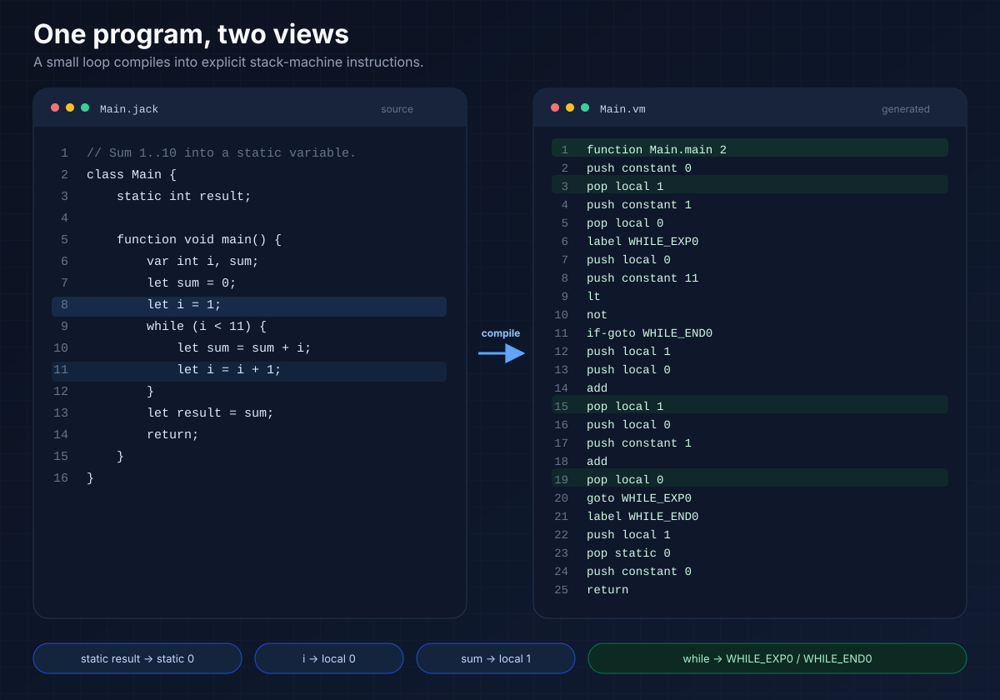

# Jack Compiler · nand2tetris Project 10 & 11




這是一個以**純 Python** 實作的 Jack 語言編譯器，支援 nand2tetris 課程的兩個階段：

- **Project 10**：Tokenizer 與 Parser，輸出課程規定的 `FooT.xml` 與 `Foo.xml`。
- **Project 11**：完整的 Jack → Hack VM 編譯器，輸出可載入 VMEmulator 的 `.vm` 檔。

編譯結果已和課程提供的官方 `JackCompiler` 做逐字比對，並且包含 36 個自動化測試。

---

## 目錄

- [專案簡介](#專案簡介)
- [功能特色](#功能特色)
- [快速開始](#快速開始)
- [圖形介面（免指令）](#圖形介面免指令)
- [使用方式](#使用方式)
- [編譯器架構](#編譯器架構)
- [編譯流程](#編譯流程)
- [範例：Jack → VM](#範例jack--vm)
- [支援的 Jack 語法](#支援的-jack-語法)
- [程式碼產生策略](#程式碼產生策略)
- [測試方式](#測試方式)
- [測試結果](#測試結果)
- [各資料夾實測結果](#各資料夾實測結果)
- [專案結構](#專案結構)
- [已知限制](#已知限制)
- [測試總結](#測試總結)
- [參考資料](#參考資料)

---

## 專案簡介

Jack 是 nand2tetris 課程設計的物件導向語言，語法接近 Java，但只能使用非常精簡的資料型別與控制結構。這個專案把 Jack 原始碼編譯成 Hack 平台的堆疊式 VM 指令，例如：

```jack
let sum = sum + i;
```

會變成：

```vm
push local 1
push local 0
add
pop local 1
```

編譯器本身不依賴任何外部套件，只使用 Python 標準函式庫。

---

## 功能特色

- ✅ 完整的 Jack tokenizer：關鍵字、符號、整數、字串、識別字、`//` 與 `/* ... */` 註解。
- ✅ 遞迴下降 parser：完整支援 class、subroutine、statement、expression 語法。
- ✅ Project 10 XML 輸出：`FooT.xml`（token stream）與 `Foo.xml`（parse tree）。
- ✅ Symbol table：`static`、`field`、`arg`、`var` 四種作用域與索引。
- ✅ Hack VM code generator：
  - constructor / function / method
  - `let`、`if/else`、`while`、`do`、`return`
  - 物件方法呼叫、類別函式呼叫、隱式 `this` 呼叫
  - 陣列讀寫、字串常數、`*` / `/` 運算子
- ✅ CLI 支援單檔、整個資料夾、遞迴編譯、指定輸出目錄。
- ✅ 內建 tkinter 圖形介面：選檔／選資料夾 → 按「開始編譯」，不用打指令。
- ✅ 36 個測試，包含 golden VM 比對與小型 VM runtime 煙霧測試。
- ✅ 無第三方依賴，Python 3.10+ 即可執行。

---

## 快速開始

需求：**Python 3.10 或更新版本**（開發與測試使用 Python 3.14）。

```bash
cd jack-compiler
python -m jackc --help
```

編譯單一檔案：

```bash
python -m jackc ../11/Pong/Main.jack
```

編譯整個資料夾：

```bash
python -m jackc ../11/Pong
```

指定輸出目錄：

```bash
python -m jackc ../11/Pong --out ../build/Pong
```

產生 Project 10 的 XML：

```bash
python -m jackc ../10/ArrayTest --xml --tokens
```

輸出會寫在來源檔旁：

```text
MainT.xml
Main.xml
```

---

## 圖形介面（免指令）

如果不想打指令，`jack-compiler` 內附一個 tkinter 圖形介面。

**Windows：** 直接雙擊 `JackCompiler-GUI.bat`。

**任何平台：**

```bash
cd jack-compiler
python -m jackc.gui
```

操作方式：

1. 按「選擇檔案…」選單一 `.jack`，或「選擇資料夾…」整個專案。
2. 勾選要產生的輸出：**VM 程式碼**、**Parse XML**、**Token XML**（可多選）。
3. 選擇輸出位置：「輸出到來源檔旁」或「輸出到指定資料夾」。
4. 按 **開始編譯**。
5. 下方「編譯紀錄」會逐檔顯示結果；「輸出預覽」顯示最後產生的內容。
6. 按「開啟輸出資料夾」可直接用檔案總管打開結果。

錯誤會以檔名＋行號＋欄號顯示在紀錄中，且單一檔案失敗不會中斷其他檔案。

> 圖形介面只是包裝，實際編譯仍由同一套 `jackc` 核心完成，輸出與 CLI 完全相同。

---

## 使用方式

### CLI 選項

| 目的 | 指令 |
|---|---|
| 編譯單檔為 `.vm` | `python -m jackc ../11/Pong/Main.jack` |
| 編譯資料夾內所有 `.jack` | `python -m jackc ../11/Pong` |
| 遞迴編譯子資料夾 | 預設會遞迴；加上 `--no-recursive` 可關閉 |
| 指定輸出資料夾 | `python -m jackc ../11/Pong --out ../build/Pong` |
| 產生 parse tree XML | `python -m jackc ../10/ArrayTest --xml` |
| 產生 token XML | `python -m jackc ../10/ArrayTest --tokens` |
| 同時產生兩種 XML | `python -m jackc ../10/ArrayTest --xml --tokens` |
| 直接印到 stdout | `python -m jackc ../09/HelloWorld/Main.jack --stdout` |

> `--stdout` 只接受單一輸入檔，避免多個檔案輸出混在一起。

### 在 VMEmulator 中執行

以 Pong 為例：

```bash
python -m jackc ../11/Pong --out ../build/Pong
```

接著開啟課程的 `tools/VMEmulator.bat`，載入 `build/Pong` 資料夾即可執行。

---

## 編譯器架構



同一份 AST 可以往兩個方向輸出：

- `--xml` / `--tokens`：給 Project 10 的 XML 比對。
- 預設：給 Project 11 的 Hack VM 程式碼。

---

## 編譯流程

1. **Tokenizer**（`jackc/tokenizer.py`）
   - 移除空白與註解。
   - 辨識五種 token：keyword、symbol、integerConstant、stringConstant、identifier。
   - 檢查整數範圍 `0..32767`、未終止字串、未終止區塊註解、非法字元。
   - 保留字串中的反斜線轉義，交由 code generator 解碼。

2. **Parser**（`jackc/parser.py`）
   - 使用遞迴下降法解析完整 Jack 文法。
   - 產生 `jackc/ast.py` 定義的 typed AST。
   - 支援 `if/else`、`while`、陣列存取、方法呼叫、括號與一元運算子。

3. **Symbol table**（`jackc/symbol_table.py`）
   - Class 層級：`static`、`field`。
   - Subroutine 層級：`arg`、`var`。
   - Method 會自動把 `argument 0` 保留給隱式 `this`。

4. **Code generator**（`jackc/compiler.py`）
   - 走訪 AST，產生 VM 指令。
   - 處理 constructor 的 `Memory.alloc`、method 的 `this` 初始化。
   - 處理物件方法呼叫、類別函式呼叫、隱式 `this` 呼叫。
   - 處理陣列讀寫、字串常數、`*` / `/` 的 OS 呼叫。

5. **Writers**
   - `jackc/vm_writer.py`：輸出 `push`、`pop`、`call`、`label`、`goto` 等 VM 指令。
   - `jackc/xml_writer.py`：輸出 Project 10 的兩種 XML 格式。

---

## 範例：Jack → VM



左邊的 Jack 程式把 1 到 10 加總到 static 變數 `result`；右邊是編譯器產生的 VM 指令。

幾個對應關係：

| Jack | VM |
|---|---|
| `static int result;` | `static 0` |
| `var int i, sum;` | `i → local 0`、`sum → local 1` |
| `while (...)` | `label WHILE_EXP0` / `if-goto WHILE_END0` |
| `let result = sum;` | `push local 1` / `pop static 0` |
| `return;`（void） | `push constant 0` / `return` |

完整的 `Main.vm` 會長這樣：

```vm
function Main.main 2
push constant 0
pop local 1
push constant 1
pop local 0
label WHILE_EXP0
push local 0
push constant 11
lt
not
if-goto WHILE_END0
push local 1
push local 0
add
pop local 1
push local 0
push constant 1
add
pop local 0
goto WHILE_EXP0
label WHILE_END0
push local 1
pop static 0
push constant 0
return
```

---

## 支援的 Jack 語法

| 類別 | 支援內容 |
|---|---|
| Class | `class`、`static` / `field` class vars、多個 subroutine |
| Subroutine | `constructor`、`function`、`method`、`void` 與類別型別回傳值 |
| 參數與區域變數 | 多個參數、多個 `var` 宣告、逗號分隔名稱 |
| Statements | `let`、`if/else`、`while`、`do`、`return` |
| Expressions | 整數、字串、`true` / `false` / `null` / `this`、變數、陣列、函式呼叫、括號、一元與二元運算子 |
| 運算子 | `+ - * / & \| < > = ~` |
| 註解 | `//`、`/* ... */`、`/** ... */` |
| 字串轉義 | `\n`、`\t`、`\r`、`\b`、`\f`、`\0`、`\a`、`\v`、`\\`、`\"`、`\'`；未知轉義會去掉反斜線 |

> Jack 沒有運算子優先順序。`2 + 3 * 4` 會由左到右解析成 `(2 + 3) * 4 = 20`，需要括號時請自行加上。

---

## 程式碼產生策略

| Jack 構造 | 產生的 VM 策略 |
|---|---|
| `static` 變數 | `push static i` / `pop static i` |
| `field` 變數 | `push this i` / `pop this i` |
| `arg` 變數 | `push argument i` / `pop argument i` |
| `var` 變數 | `push local i` / `pop local i` |
| Constructor | `push constant fieldCount` → `call Memory.alloc 1` → `pop pointer 0` |
| Method | `push argument 0` → `pop pointer 0` |
| `obj.method(args)` | push `obj`、push args、`call Class.method n+1` |
| `Class.function(args)` | push args、`call Class.function n` |
| 隱式 `method(args)` | `push pointer 0`、push args、`call CurrentClass.method n+1` |
| 陣列讀取 `a[i]` | index、base、`add`、`pop pointer 1`、`push that 0` |
| 陣列寫入 `a[i] = v` | index、base、`add`、value、`pop temp 0`、`pop pointer 1`、`push temp 0`、`pop that 0` |
| `*` / `/` | `call Math.multiply 2` / `call Math.divide 2` |
| `true` | `push constant 0` → `not` |
| 字串常數 | `String.new` + 逐字 `String.appendChar` |
| `if/else` | `IF_TRUE` / `IF_FALSE` / `IF_END` 標籤 |
| `while` | `WHILE_EXP` / `WHILE_END` 標籤 |

標籤編號刻意重現官方編譯器風格：`if` 與 `while` 使用各自獨立的計數器，且每個 subroutine 重新從 0 開始。

---

## 測試方式

測試分成四層：

1. **單元測試**
   - Tokenizer 的 token 辨識、註解、字串、錯誤處理。
   - Parser 的 AST 結構與語法錯誤位置。
   - Symbol table 與 code generator 的關鍵行為。

2. **Project 10 XML 比對**
   - 直接編譯 `projects/10` 內的 `.jack`。
   - 將產生的 `FooT.xml` / `Foo.xml` 與課程附的參考檔逐字比對。

3. **Project 9 / 11 / 12 golden VM 比對**
   - 先用官方 `tools/JackCompiler.bat` 產生 golden `.vm`。
   - 再用本編譯器編譯相同 `.jack`，逐字比對輸出。
   - Golden 檔位於 `tests/golden/vm/`。

4. **Runtime 煙霧測試**
   - `tests/vm_runtime.py` 是一個小型 Hack VM 解譯器。
   - 執行不依賴 OS 的 Jack 程式，確認 while、if/else、函式呼叫、四則運算的實際結果。

### 執行測試

```bash
cd jack-compiler
python -m unittest discover -s tests -t . -v
```

也可以使用 pytest：

```bash
python -m pytest -q
```

測試不需要 Java。只有在需要重新產生 golden 檔時，才需要課程的官方編譯器：

```bash
python tests/generate_golden.py
```

---

## 測試結果

以下是實際執行結果（其中一次執行）：

```text
$ python -m unittest discover -s tests -t . -v
...
test_vm_output_matches_official_compiler ... ok
test_parse_tree_xml_matches_reference ... ok
test_token_xml_matches_reference ... ok
test_while_loop_and_static_variable ... ok
...
----------------------------------------------------------------------
Ran 36 tests in 0.656s

OK
```

| 測試範圍 | 目錄數 | `.jack` 檔數 | 驗證方式 | 結果 |
|---|---:|---:|---|---|
| Project 10 | 3 | 7 | XML + T.xml 逐字比對 | **7 / 7 PASS** |
| Project 9 | 8 | 15 | `.vm` 與官方編譯器逐字比對 | **15 / 15 PASS** |
| Project 11 | 6 | 11 | `.vm` 與官方編譯器逐字比對 | **11 / 11 PASS** |
| Project 12 測試程式 | 9 | 9 | `.vm` 與官方編譯器逐字比對 | **9 / 9 PASS** |
| Project 12 OS stubs | 1 | 8 | 可成功編譯（官方會因缺 `return` 拒絕） | **8 / 8 PASS** |
| 自動化測試 | — | — | `unittest` | **36 / 36 PASS** |

**Golden 差異數：0。**

> Project 12 的 `Array.jack`、`Math.jack`、`String.jack` 等是課程提供的未完成 OS stub，函式本體是空的。官方編譯器會報「may reach end of subroutine without return」並拒絕輸出；本編譯器會自動補上預設 `return`，因此可以編譯。這是刻意的容錯行為，不是測試失敗。

---

## 各資料夾實測結果

### Project 10（7 / 7）

| 資料夾 | 檔案 | 結果 |
|---|---|---|
| `ArrayTest` | `Main.jack` | ✅ XML + T.xml |
| `ExpressionLessSquare` | `Main.jack`、`Square.jack`、`SquareGame.jack` | ✅ XML + T.xml |
| `Square` | `Main.jack`、`Square.jack`、`SquareGame.jack` | ✅ XML + T.xml |

### Project 9（15 / 15）

| 資料夾 | 檔案 | 結果 |
|---|---|---|
| `Average` | `Main.jack` | ✅ |
| `ComplexArrays` | `Main.jack` | ✅ |
| `ConvertToBin` | `Main.jack` | ✅ |
| `Fraction` | `Fraction.jack`、`Main.jack` | ✅ |
| `HelloWorld` | `Main.jack` | ✅ |
| `List` | `List.jack`、`Main.jack` | ✅ |
| `Pong` | `Ball.jack`、`Bat.jack`、`Main.jack`、`PongGame.jack` | ✅ |
| `Square` | `Main.jack`、`Square.jack`、`SquareGame.jack` | ✅ |

### Project 11（11 / 11）

| 資料夾 | 檔案 | 結果 |
|---|---|---|
| `Average` | `Main.jack` | ✅ |
| `ComplexArrays` | `Main.jack` | ✅ |
| `ConvertToBin` | `Main.jack` | ✅ |
| `Pong` | `Ball.jack`、`Bat.jack`、`Main.jack`、`PongGame.jack` | ✅ |
| `Seven` | `Main.jack` | ✅ |
| `Square` | `Main.jack`、`Square.jack`、`SquareGame.jack` | ✅ |

### Project 12 測試程式（9 / 9）

| 資料夾 | 檔案 | 結果 |
|---|---|---|
| `ArrayTest` | `Main.jack` | ✅ |
| `KeyboardTest` | `Main.jack` | ✅ |
| `MathTest` | `Main.jack` | ✅ |
| `MemoryTest` | `Main.jack` | ✅ |
| `MemoryTest/MemoryDiag` | `Main.jack` | ✅ |
| `OutputTest` | `Main.jack` | ✅ |
| `ScreenTest` | `Main.jack` | ✅ |
| `StringTest` | `Main.jack` | ✅ |
| `SysTest` | `Main.jack` | ✅ |

### Project 12 OS stubs（8 / 8）

| 檔案 | 結果 |
|---|---|
| `Array.jack` | ✅ 可編譯 |
| `Keyboard.jack` | ✅ 可編譯 |
| `Math.jack` | ✅ 可編譯 |
| `Memory.jack` | ✅ 可編譯 |
| `Output.jack` | ✅ 可編譯 |
| `Screen.jack` | ✅ 可編譯 |
| `String.jack` | ✅ 可編譯 |
| `Sys.jack` | ✅ 可編譯 |

---

## 專案結構

```text
jack-compiler/
├── jackc/
│   ├── __init__.py        # 套件入口
│   ├── __main__.py        # python -m jackc
│   ├── ast.py             # Jack AST 節點
│   ├── cli.py             # 命令列介面
│   ├── compiler.py        # Jack → VM code generator
│   ├── errors.py          # JackError
│   ├── gui.py             # tkinter 圖形介面
│   ├── parser.py          # 遞迴下降 parser
│   ├── symbol_table.py    # static / field / arg / var
│   ├── tokenizer.py       # Jack tokenizer
│   ├── vm_writer.py       # VM 指令輸出
│   └── xml_writer.py      # Project 10 XML 輸出
├── tests/
│   ├── golden/vm/         # 官方編譯器產生的 golden VM
│   ├── generate_golden.py # 重新產生 golden（需要 Java）
│   ├── helpers.py
│   ├── test_cli.py
│   ├── test_runtime.py
│   ├── test_tokenizer.py
│   ├── test_vm.py
│   ├── test_xml.py
│   └── vm_runtime.py      # 測試用迷你 VM 解譯器
├── docs/
│   ├── architecture.svg   # 靜態版架構圖（可選）
│   ├── banner.svg
│   └── example.svg
├── JackCompiler-GUI.bat   # Windows 雙擊啟動圖形介面
└── README.md
```

---

## 已知限制

- **不做完整型別檢查**：語法與符號解析是完整的，但沒有 Java 等級的靜態型別驗證。未宣告變數會在 code generation 階段以 `JackError` 回報。
- **不含 VM emulator 或 Hack OS**：`Pong`、`Square` 等程式仍需要在課程提供的 VMEmulator 中執行；本專案只負責產生 `.vm`。
- **Project 12 OS stub 的容錯**：空函式會自動補上預設 `return`，與官方編譯器的嚴格行為不同。
- **字串轉義依官方行為**：`\n`、`\t`、`\\`、`\"`、`\]` 等會解碼；未知轉義會去掉反斜線。
- **沒有最佳化**：以可讀性與「和官方編譯器輸出一致」為主要目標，不進行指令合併或常數摺疊。

---

## 測試總結

- Project 10：**7 / 7** 個 `.jack` 檔的 XML 與參考檔逐字比對通過。
- Project 9：**15 / 15** 個 VM 檔與官方編譯器逐字比對通過。
- Project 11：**11 / 11** 個 VM 檔與官方編譯器逐字比對通過。
- Project 12 測試程式：**9 / 9** 個 VM 檔與官方編譯器逐字比對通過。
- Project 12 OS stubs：**8 / 8** 可編譯（官方編譯器會因缺少 `return` 拒絕，非失敗）。
- 自動化測試：**36 / 36** 通過。
- 與官方 `JackCompiler` 的 golden 差異：**0**。

**目前沒有未通過的測試。** 編譯器在 Project 10、Project 9、Project 11、Project 12 測試程式上都已通過；唯一與官方行為不同的是對 Project 12 空函式 stub 的容錯，這是刻意設計。

---

## 參考資料

- Noam Nisan and Shimon Schocken, *The Elements of Computing Systems*, MIT Press.
- [nand2tetris 官方網站](https://www.nand2tetris.org/)
- nand2tetris 課程提供的 `tools/JackCompiler.bat`（作為 golden 輸出與行為參考）。
