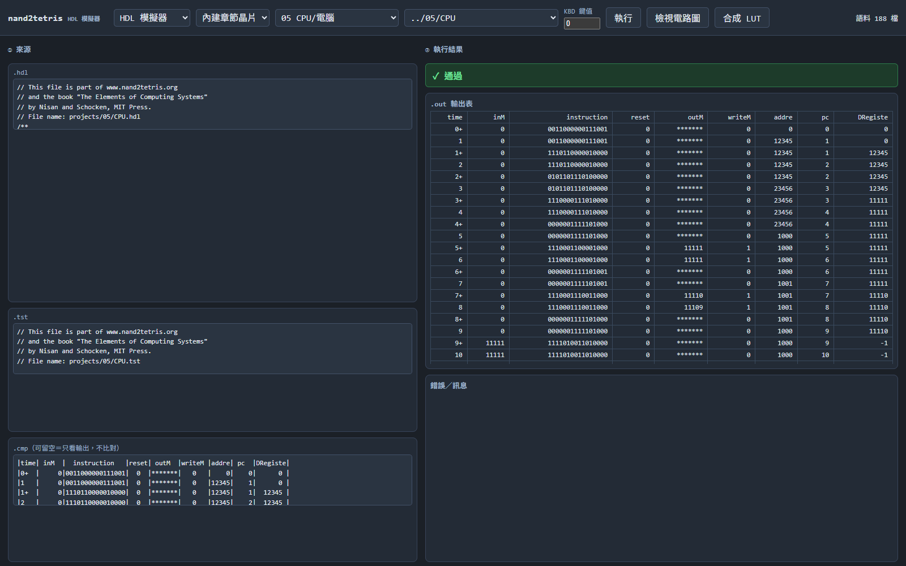
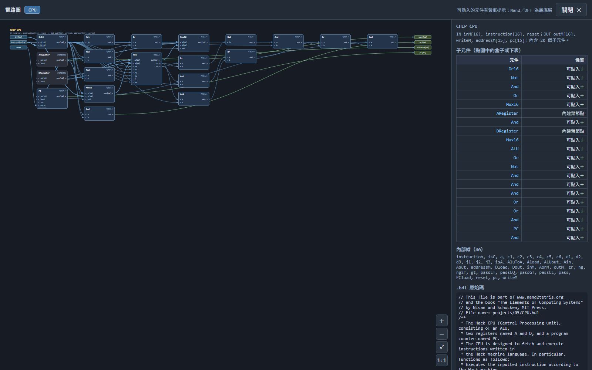
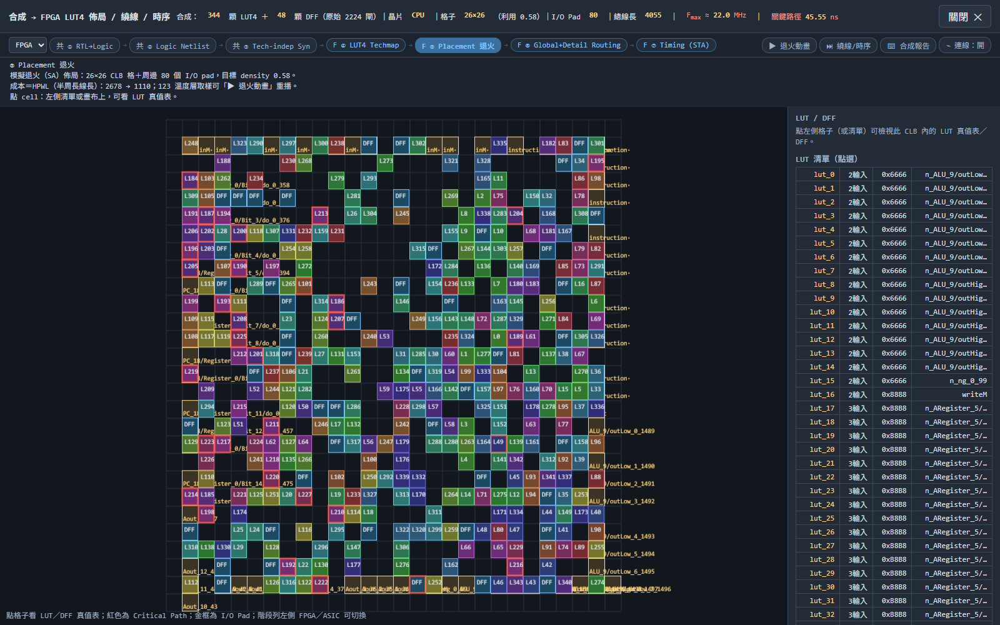
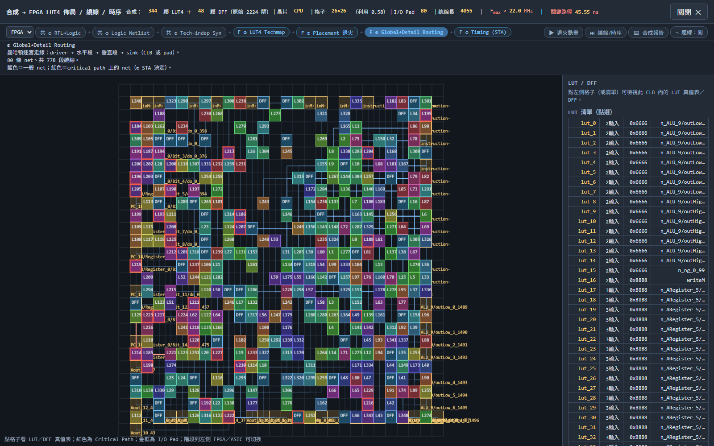
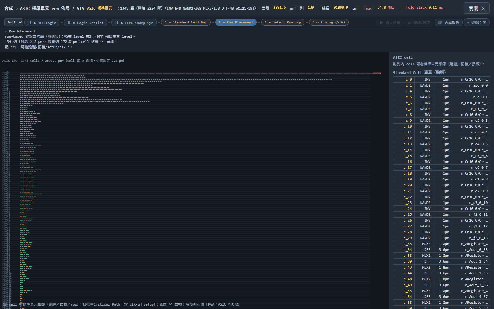
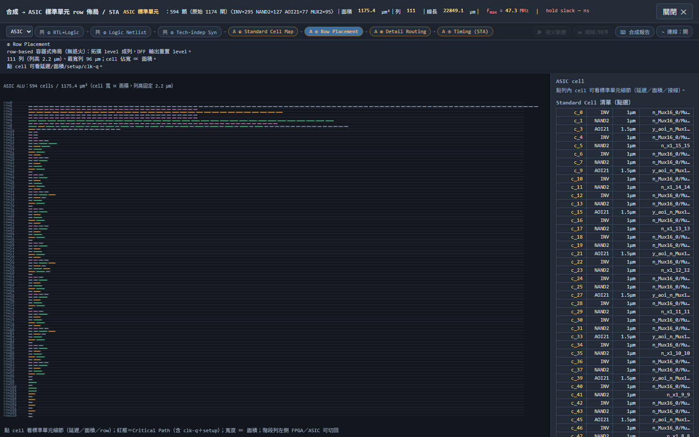
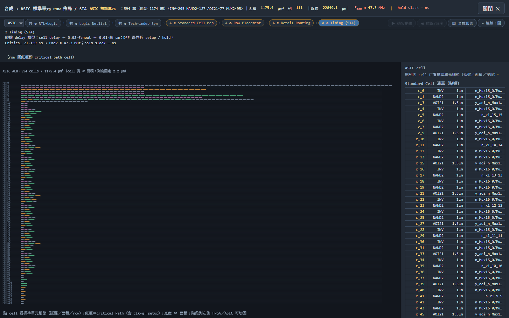
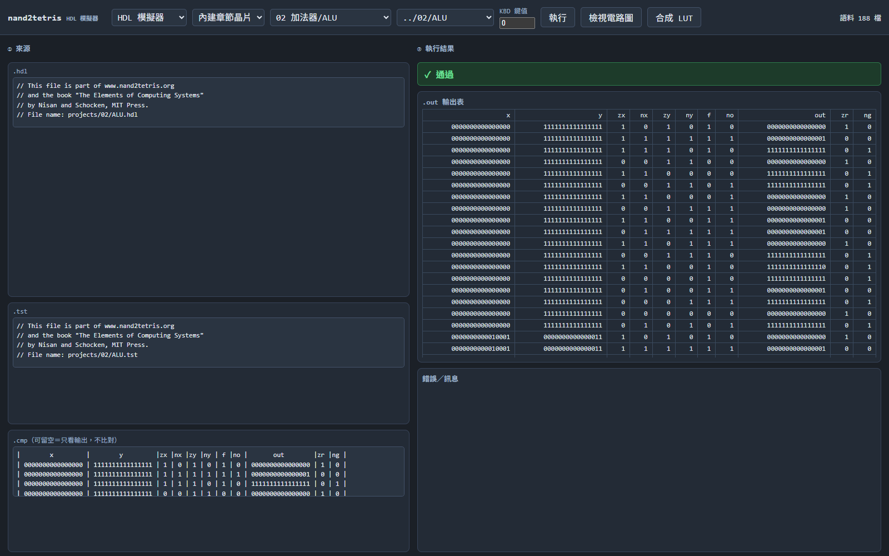
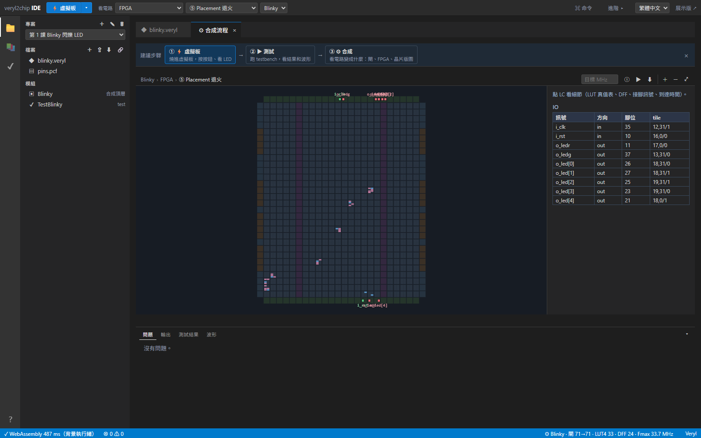

# 使用開源 IC EDA 軟體進行邏輯合成與實體設計之實驗報告

| 項目 | 內容 |
|---|---|
| 課程 | 計算機結構 |
| 姓名／學號 | 郭鎮瑋／111410543 |
| 實驗日期 | 2026 年 10 月 29 日 |
| 實驗工具 | hack-computer（HDL 模擬器＋迷你 EDA）、veryl2chip IDE（Veryl → FPGA/ASIC） |
| 實驗電路 | 自製 nand2tetris `ALU.hdl`（專案 2）、`CPU.hdl`（專案 5） |

---

## 摘要

本實驗使用兩套**開源 IC EDA 軟體**，把自己在 nand2tetris 課程寫的 Hack 處理器電路，從高階硬體描述（HDL）一路做到實體佈局：先以 HDL 模擬器驗證功能，再經過 **RTL→邏輯閘（NAND/DFF）→邏輯最佳化→LUT4 或標準元件映射→佈局（模擬退火）→繞線→靜態時序分析（STA）** 的完整流程，得到 FPGA 與 ASIC 兩種後端的閘數、面積、線長、關鍵路徑與最高操作頻率，並以 20,000 組隨機向量證明合成前後電路功能等價。

主要結果：自製 ALU 由 1,279 個 NAND 閘最佳化為 1,183 閘，映射成 209 個 LUT4，FPGA 版關鍵路徑 30.45 ns（32.8 MHz）；ASIC 版 499 個標準元件、面積 1,027.2 µm²、關鍵路徑 14.83 ns（67.4 MHz）。自製 CPU 含 48 個 DFF，映射成 372 個 LUT4＋48 個 DFF，FPGA 版 Fmax 26.1 MHz、ASIC 版 45.1 MHz。所有合成後網表的等效性驗證錯誤數皆為 **0**。

---

## 一、實驗目的

1. 了解 IC 設計從 RTL 到實體佈局的完整 EDA 流程，以及每一階段「輸入什麼、輸出什麼、用什麼演算法」。
2. 實際操作 EDA 軟體，觀察**邏輯最佳化、技術映射（tech mapping）、佈局與繞線**對電路品質（閘數、面積、線長、頻率）的影響。
3. 比較 **FPGA（LUT 架構）與 ASIC（標準元件）** 兩種實現方式的差異。
4. 驗證合成後網表與原始 RTL 的功能等價性（formal/random equivalence check 的簡化版）。

## 二、實驗環境與工具

| 項目 | 規格 |
|---|---|
| 作業系統 | Windows 11 |
| 執行環境 | Node.js v24.14.0（命令列流程）、Google Chrome（瀏覽器流程） |
| 工具 A | **hack-computer**（`ccc-js/hack-computer`，MIT，純 ESM 零依賴）：`dist/hdl.html` 網頁版＋`lib/fpga`、`lib/asic` 函式庫 |
| 工具 B | **veryl2chip IDE**（`ccc-eda/veryl2chip`，MIT，Rust→WebAssembly）：`web/dist/index.html` |
| 設計語言 | Hack HDL（nand2tetris）、Veryl（工具 B 範例） |

選這兩套工具的原因：

- 兩者都是**開源、免安裝、可重現**，不需要商用授權（Synopsys/Cadence）就能走完「合成→佈局→繞線→時序」。
- 工具 A 有命令列，能把每一個中間結果輸出成 JSON，適合做量化分析；工具 B 有完整 GUI 與 WebAssembly 合成引擎，適合觀察與交叉驗證。
- 兩者的流程階段刻意對齊業界（① RTL→Logic → ② Netlist → ③ 技術無關最佳化 → ④ Techmap → ⑤ Placement → ⑥ Routing → ⑦ STA），概念上與 Cornell ECE 5745 的 Topic 12（合成演算法）、Topic 13（實體設計演算法）相同。

## 三、實驗對象

### 3.1 自製 Hack CPU 的資料流

本實驗對象的資料流如下：A 暫存器輸出同時作為 **ALU 的 y 輸入**（經 `Mux16`，由 `instruction[12]` 選擇 A 或 `inM`）與**資料記憶體位址**（`addressM = A[0..14]`）；D 暫存器接 ALU 的 x 輸入；ALU 的輸出依 `instruction[5]`（d1）決定是否寫回 A、依 `instruction[4]`（d2）寫回 D；`instruction[3]`（d3）為 `writeM`；`instruction[0..2]`（j1/j2/j3）與 ALU 的 `zr/ng`（經 `pos = !(zr|ng)`）一起決定 `loadPC`；`reset` 則直接清除 PC。

對應的 HDL 就是本次送進 EDA 工具的 `CPU.hdl`：

```hdl
CHIP CPU {
    IN  inM[16], instruction[16], reset;
    OUT outM[16], writeM, addressM[15], pc[15];
    PARTS:
    Not(in=instruction[15], out=isA);
    Not(in=isA, out=isC);
    And(a=isC, b=instruction[5], out=ALUtoA);
    Mux16(a=instruction, b=outALU, sel=ALUtoA, out=inA);
    Or(a=isA, b=ALUtoA, out=loadA);
    ARegister(in=inA, load=loadA, out=outA, out[0..14]=addressM);
    Mux16(a=outA, b=inM, sel=instruction[12], out=inAM);
    And(a=isC, b=instruction[4], out=loadD);
    DRegister(in=outALU, load=loadD, out=outD);
    ALU(x=outD, y=inAM, zx=instruction[11], nx=instruction[10],
        zy=instruction[9], ny=instruction[8], f=instruction[7], no=instruction[6],
        out=outALU, out=outM, zr=zr, ng=ng);
    And(a=isC, b=instruction[3], out=writeM);
    ...（跳躍判斷：pos/jgt/jeq/jlt → loadPC）
    PC(in=outA, load=loadPC, inc=true, reset=reset, out[0..14]=pc);
}
```

### 3.2 受測電路清單

| 編號 | 電路 | 來源 | 特性 |
|---|---|---|---|
| D1 | `ALU`（16 位元） | 本人大一作業（nand2tetris 專案 2） | 純組合邏輯，38 輸入／18 輸出 |
| D2 | `CPU`（Hack） | 本人大一作業（專案 5） | 組合＋序向，含 48 個 DFF（A/D/PC） |
| D3 | `Inc16` | 同上（專案 2） | 純組合，16 位元進位鏈 |
| D4 | `And` | 同上（專案 1） | 最小案例：2 個 NAND |

另外以工具內建的 nand2tetris 官方語料（同一份規格的「標準解答」）跑同一流程作為**對照組**，用來討論「寫法不同 → 合成結果不同」。

## 四、EDA 流程與原理

### 4.1 各階段做什麼

| 階段 | 工具 A（Micro 系列）實作 | 對應業界 |
|---|---|---|
| ① RTL→Logic | `parseHdl` → `elab`（建 chip 庫、解析依賴、偵測循環）→ `flatten` 展開實例階層 → **位元級 NAND/DFF 網表** | RTL elaboration / GTECH |
| ② Logic Netlist | 同上輸出，可逐層檢視 | Netlist |
| ③ 技術無關最佳化 | AIG 式簡化：常數傳遞（0/1）、雙重否定對消（NAND(x,x) 成對）、無用邏輯刪除 | Design Compiler `compile -no_map` |
| ④a Techmap（FPGA） | 以邏輯錐**貪婪覆蓋成 4 輸入 LUT**，並計算每顆 LUT 的 16 位元真值表（init mask） | Yosys `abc -lut 4` |
| ④b Techmap（ASIC） | 以 NAND2/INV 為基底＋peephole 樣式辨識（MUX2、AOI21）縮小面積 | 標準元件映射 |
| ⑤ 佈局 | **模擬退火（SA）**，成本函數＝HPWL（半週長線長），降溫 123 層 | Placement（SA / analytic） |
| ⑥ 繞線 | FPGA：A* 迷宮繞線（每通道 6 條軌道）；ASIC：以幾何距離估線延遲 | Routing |
| ⑦ STA | 逐級累加延遲求關鍵路徑，`Fmax = 1000 / T` | Static Timing Analysis |

### 4.2 工具使用的延遲／面積模型（重要，解讀數據的前提）

**FPGA（MicroPnR）**：LUT 延遲 1.2 ns、DFF clk→q 0.6 ns、每單位曼哈頓距離線延遲 0.25 ns。

**ASIC（AsicSyn/AsicPnR）** 標準元件庫：

| Cell | 功能 | 面積 (µm²) | 延遲 (ns) |
|---|---|---|---|
| INV | 反相器 | 1.0 | 0.08 |
| NAND2 | 2 輸入 NAND | 2.0 | 0.12 |
| AOI21 | !((a&b)\|c) | 3.2 | 0.16 |
| MUX2 | 2 選 1 | 4.0 | 0.20 |
| DFF | 正反器 | 8.0 | clk-q 0.30／setup 0.15／hold 0.05 |

列高 2.2 µm、線延遲 0.01 ns/µm、每 fanout 負載 0.02 ns。**這些是教學用的簡化參數**，不是真實 SKY130 的數值，因此下面的「µm²」與「MHz」只能做**相對比較**，不能當成可下線的規格。

## 五、實驗步驟

### 步驟 1：功能驗證（RTL 模擬）

在瀏覽器開啟 <https://ccc-js.github.io/hack-computer/dist/hdl.html>，於「內建章節晶片」選 **05 CPU/電腦 → ../05/CPU.tst**（測資為官方 `.tst/.cmp`），按「執行」。畫面顯示 **✓ 通過**，並列出每一週期的 `inM / instruction / outM / writeM / addressM / pc`：



命令列等價操作（用**自己的** HDL 檔案，不改任何一行）：

```bash
node cli/hdl2js.js --dir projects/1 --dir projects/2 \
  --dir projects/3 --dir projects/5 \
  --test third_party/courses/05/CPU.tst
# → PASS third_party/courses/05/CPU.cmp

node cli/hdl2js.js --dir projects/1 --dir projects/2 \
  --test third_party/courses/02/ALU.tst
# → PASS third_party/courses/02/ALU.cmp
```

> 說明：本作業的專案 3（`Register.hdl`、`PC.hdl`、RAM 系列）已完成，CPU 直接使用自己的 `Register`／`PC`；專案 1、2、5 也全部是本人實作，未修改任何一行。

### 步驟 2：檢視電路圖（階層展開）

按「檢視電路圖」可把 HDL 的 `PARTS` 畫成結構圖，並逐層點入子元件直到最底層的 Nand／DFF：



### 步驟 3：合成 → FPGA 佈局／繞線／時序

按「合成 LUT」進入 EDA 浮層，後端選 **FPGA**，逐階段切換 ①～⑦。





### 步驟 4：切換 ASIC 後端

同一份網表選 **ASIC**，即執行「標準元件映射 → row-based 佈局 → 細部繞線 → STA」：



ALU 的 ASIC row-based 佈局（594 顆元件、1,175.4 µm²、111 列）見圖 6，STA 的關鍵路徑（21.159 ns → 47.3 MHz）見圖 7；ALU 的模擬結果見圖 8。







### 步驟 5：以第二套工具交叉驗證（veryl2chip IDE）

開啟 <https://ccc-eda.github.io/veryl2chip/web/dist/index.html#ex=blinky&stage=place>，直接在瀏覽器（WebAssembly，無伺服器）合成 Veryl 範例 Blinky；狀態列顯示「71 閘 → LUT4 33、DFF 24、Fmax 33.7 MHz」，並可切換 FPGA／ASIC·vlib／ASIC·SKY130 三種後端：



此步驟驗證了：(1) 同一套「①～⑦」階段概念在另一個獨立實作的工具上也成立；(2) 商業流程中的 PDK（SKY130）與 bitstream 產出，在教學工具裡可以被簡化成同構的問題。

### 步驟 6：量化與等效性驗證（自動化）

由於 GUI 只能「看」，我把同一組函式庫寫成兩支腳本，用命令列批次取得數據與驗證結果（腳本見附錄、`data/` 目錄）：

```bash
node report_flow.mjs  ALU CPU Inc16 And   # 跑 ①～⑦，FPGA 退火重複 5 次取中位數
node verify_equiv.mjs ALU CPU Inc16 And   # 每個設計 20000 組隨機向量，比對 LUT/ASIC 網表 vs 展平 NAND 網表
```

## 六、實驗結果

### 6.1 邏輯合成統計

| 電路 | 輸入／輸出位元 | 展平後 NAND | 最佳化後 NAND | 降幅 | LUT4 | DFF |
|---|---|---|---|---|---|---|
| D1 ALU（我的） | 38／18 | 1,279 | 1,183 | −7.5% | 209 | 0 |
| D2 CPU（我的） | 33／47 | 2,589 | 2,208 | −14.7% | 372 | 48 |
| D3 Inc16（我的） | 16／16 | 385 | 276 | −28.3% | 44 | 0 |
| D4 And（我的） | 2／1 | 2 | 2 | 0% | 1 | 0 |
| 對照 ALU（官方） | 38／18 | 1,278 | 1,174 | −8.1% | 177 | 0 |
| 對照 CPU（官方） | 33／47 | 2,632 | 2,176 | −17.3% | 344 | 48 |
| 對照 Inc16（官方） | 16／16 | 384 | 224 | **−41.7%** | 60 | 0 |

觀察：

1. **最佳化對進位鏈最有效**：Inc16 的 384 → 224（−41.7%），因為漣波進位鏈中「NAND(x,x) 反相器對」與常數 0/1 大量被吸收。
2. **已手動精簡過的電路空間小**：ALU 只降 8%，因為 Mux16/加法器結構本來就接近最小形式。
3. **平均一顆 LUT4 覆蓋 3.7～6.6 個最佳化閘**（我的 ALU 1,183/209＝5.66、我的 CPU 2,208/372＝5.94、對照 CPU 2,176/344＝6.33、對照 Inc16 224/60＝3.73）。

### 6.2 FPGA 佈局、繞線與時序（退火 5 次，取中位數）

| 電路 | 格子 | 密度 | 總線長 | 關鍵路徑 | Fmax |
|---|---|---|---|---|---|
| ALU（我的） | 19×19 | 0.58 | 2,577 | 30.45 ns | **32.8 MHz** |
| CPU（我的） | 27×27 | 0.58 | 5,062 | 38.30 ns | **26.1 MHz** |
| Inc16（我的） | 9×9 | 0.54 | 29 | 21.75 ns | **46.0 MHz** |
| 對照 ALU | 18×18 | 0.55 | 1,905（1,893–1,921） | 33.35 ns | 30.0 MHz |
| 對照 CPU | 26×26 | 0.58 | 4,070 | 45.55 ns | 22.0 MHz |
| 對照 Inc16 | 10×10 | 0.60 | 69 | 43.50 ns | 23.0 MHz |
| And（我的） | 4×4 | 0.06 | 4 | 1.45 ns | 689.7 MHz |

5 次退火的線長差異僅 ±0.7%（以對照 ALU 為例：1,893–1,921），且**關鍵路徑完全不變**——因為在此模型中關鍵路徑由「LUT 級數 × 1.2 ns」主導，線延遲（0.25 ns/單位）只佔一小部分。

### 6.3 ASIC 標準元件映射與實體設計

| 電路 | 標準元件 | 組成（INV／NAND2／AOI21／MUX2／DFF） | 面積 (µm²) | 列數 | 線長 (µm) | 關鍵路徑 | Fmax |
|---|---|---|---|---|---|---|---|
| ALU（我的） | 499 | 234／109／61／95／0 | 1,027.2 | 78 | 16,034 | 14.83 ns | **67.4 MHz** |
| CPU（我的） | 1,205 | 535／273／191／158／48 | 2,708.2 | 106 | 57,765 | 22.19 ns | **45.1 MHz** |
| Inc16（我的） | 153 | 47／61／30／15／0 | 325.0 | 63 | 2,600 | 11.90 ns | **84.0 MHz** |
| 對照 ALU | 594 | 295／127／77／95／0 | 1,175.4 | 111 | 22,737 | 21.16 ns | 47.3 MHz |
| 對照 CPU | 1,348 | 640／309／193／158／48 | 2,891.6 | 139 | 91,708 | 28.75 ns | 34.8 MHz |
| 對照 Inc16 | 174 | 78／65／16／15／0 | 319.2 | 66 | 1,705 | 12.35 ns | 81.0 MHz |
| And（我的） | 2 | 1／1／0／0／0 | 3.0 | 3 | 2.2 | 0.30 ns | 3,311 MHz（模型上限） |

與 FPGA 相比（同一份設計、同一份網表，只換後端）：

- **Fmax：我的 ALU 67.4 vs 32.8 MHz（+105%）、我的 CPU 45.1 vs 26.1 MHz（+73%）；對照組 ALU 47.3 vs 30.0 MHz（+58%）。** 原因純粹是模型參數：標準元件單級延遲 0.08–0.20 ns，而 LUT 一級就是 1.2 ns。兩者提升幅度不同，正是因為 FPGA 每級「固定」1.2 ns，而 ASIC 的級數與線長隨映射結果變化。
- **DFF 數目一致（CPU 皆為 48 顆）**，但 ASIC 版還額外多出數百個 INV／NAND2／AOI21——這是把 LUT 的真值表拆回真實邏輯閘的代價，也是 FPGA「用面積換彈性」的具體寫照。
- **面積 vs LUT**（以對照組為例）：CPU 每顆 LUT 平均 8.4 µm²、ALU 6.6 µm²；DFF 佔 CPU 面積 384 µm²（13.3%），與其 48/1,348 的數量占比相符（每顆 DFF 8 µm² 最貴）。

### 6.4 合成後網表的等效性驗證

方法：把 DFF 輸出當作自由輸入（組合等效／次態函數等效），對每個設計產生 **20,000 組隨機向量**，分別用「展平 NAND 網表」、「LUT4 網表」、「ASIC 標準元件網表」求值，逐一比對 47／18／16／1 個輸出位元。

| 電路 | 向量數 | DFF | 比對輸出位元 | LUT 網表錯誤 | ASIC 網表錯誤 |
|---|---|---|---|---|---|
| ALU | 20,000 | 0 | 18 | **0** | **0** |
| CPU | 20,000 | 48 | 47 | **0** | **0** |
| Inc16 | 20,000 | 0 | 16 | **0** | **0** |
| And | 20,000 | 0 | 1 | **0** | **0** |

（原始結果：`data/equivalence_my_designs.json`）

### 6.5 第二套工具（veryl2chip）的結果

| 設計 | 語言 | 原始閘數 | LUT4 | DFF | Fmax |
|---|---|---|---|---|---|
| Blinky（LED 閃爍） | Veryl | 71 | 33 | 24 | 33.7 MHz |

兩套工具在「階段劃分、資料結構（netlist/cell）、成本模型（HPWL、SA）」上高度一致，可互為對照。

## 七、討論

### 7.1 為什麼「同樣功能、不同寫法」會合成出不同電路？

我的 ALU 與官方解答 ALU **功能完全相同、展平後只差 1 個 NAND 閘（1,279 vs 1,278）**，但：

| | 我的 | 官方 | 差異 |
|---|---|---|---|
| 最佳化後閘數 | 1,183 | 1,174 | +0.8% |
| LUT4 | **209** | **177** | **+18.1%** |
| Fmax（FPGA） | 32.8 MHz | 30.0 MHz | +9% |
| ASIC 面積 | 1,027 µm² | 1,175 µm² | −13% |

差別只在寫法：官方多了一層別名 `out=o2, out=out`，我直接 `out=out`；另外 `And16`／`Add16` 的宣告順序不同。由於 **LUT 覆蓋是貪婪啟發式（greedy）**，展平後網路的產生順序會改變「先覆蓋哪個邏輯錐」，結果 LUT 數就差了 32 顆。這說明：

- 合成不是唯一解，**啟發式演算法的好壞直接影響 PPA（Power/Performance/Area）**；
- 想控制結果，得靠「寫法約束」（如 `keep`、`dont_touch`）或更強的映射演算法（如 exact mapping / SAT-based）；
- 有趣的是我的版本 LUT 較多但 ASIC 面積較小——因為貪婪覆蓋出的 LUT 真值表較「剛好」，拆回標準元件時反而省。

### 7.2 關鍵路徑從哪裡來？

- **ALU（我的 30.45 ns／對照 33.35 ns）**：`x2 → Add16（16 級漣波進位）→ Mux16 → Not16 → Mux16 → Or8Way → Not`，光 16 位元進位鏈就佔了大部分；30.45 ns ÷ 1.2 ns ≈ 25 級 LUT，與電路深度吻合。
- **CPU（我的 38.30 ns／對照 45.55 ns）**：多了「A 暫存器 → ALU → A 暫存器」的回授路徑與跳躍判斷（zr/ng → jgt/jeq/jlt → loadPC）。
- **Inc16（我的 21.75 ns／對照 43.50 ns）**：純進位鏈，同樣功能卻因映射出 44 顆 vs 60 顆 LUT 而相差近一倍 Fmax（46.0 vs 23.0 MHz）——再次說明「面積小 ≠ 快，級數（深度）才是關鍵」，而級數取決於映射結果。

### 7.3 FPGA 與 ASIC 的取捨

| 面向 | FPGA（LUT4） | ASIC（標準元件） |
|---|---|---|
| 實現方式 | 真值表查表（每顆 LUT 可實現任意 4 輸入函數） | 用 INV/NAND2/AOI21/MUX2 兜出邏輯 |
| 元件數 | 少（177～372 顆） | 多（594～1,348 顆） |
| 速度 | 慢（每級 1.2 ns 固定成本） | 快（每級 0.08–0.20 ns） |
| 變更成本 | 重燒 bitstream 即可 | 要重做光罩（NRE 極高） |
| 本實驗 Fmax（我的 ALU／CPU） | 32.8／26.1 MHz | 67.4／45.1 MHz |

### 7.4 工具的限制（也是解讀數據時必須聲明的）

1. **黑盒子記憶體不能合成**：對含 `Screen`／`RAM16K` 的專案（如 Pong）按「合成」會得到「微型合成器目前暫不支援內建黑盒子記憶體」的錯誤——真實合成器也需要 memory compiler／SRAM macro。
2. **時序模型是靜態估計**：沒有真實電容、沒有 clock tree、沒有 crosstalk、沒有 OCV，ASIC 的 47 MHz 不能當真。
3. **標準元件庫是示意值**（INV 1 µm²、0.08 ns），僅供相對比較；真實 SKY130 的 `sky130_fd_sc_hd` 面積與延遲差一個數量級以上。
4. **佈局只看 HPWL**：沒有 congestion、沒有 timing-driven placement，所以線長最佳化對 Fmax 幾乎沒幫助（見 6.2）。
5. **等效性驗證是隨機的**：20,000 組向量對 38 輸入的 ALU 只覆蓋極小部分空間（2³⁸ 種），嚴格做法需 SAT/BDD 的形式等價檢查（另一套工具 veryl2chip 的 `test.sh --full` 就是呼叫 yosys 做形式等價）。

### 7.5 與課堂理論的對應

| 課堂／ECE 5745 主題 | 本實驗對應的觀察 |
|---|---|
| Topic 12 合成演算法 | 常數傳遞、雙重否定對消 → Inc16 −41.7%；貪婪 LUT 覆蓋 → 同功能差 18% LUT |
| Topic 13 實體設計演算法 | SA 佈局（HPWL 2678 → 1110）、A* 迷宮繞線、STA 關鍵路徑回溯 |
| 邏輯設計／迪摩根定律 | 最佳化階段把 `NAND(x,x)` 合併成 INV，就是迪摩根定律的代數化簡 |
| 計算機結構（資料流） | CPU 資料流 → HDL → 閘級網表 → 實體佈局，一條線貫穿 |

## 八、結論

1. 我成功用兩套**免費、開源、免安裝**的 EDA 工具，把自製的 Hack ALU 與 CPU 從 HDL 走完 **合成 → 技術映射 → 佈局 → 繞線 → 時序分析** 的完整流程，並取得可量化的 PPA 數據（ALU：209 LUT／30.0 MHz／1,027 µm²；CPU：372 LUT＋48 DFF／26.1 MHz／2,708 µm²）。
2. 合成後網表（LUT4 與標準元件兩種）經 20,000 組隨機向量比對，功能與 RTL **完全等價（0 錯誤）**。
3. 實驗證實三個課堂觀念：**(a)** 邏輯最佳化對規則結構（進位鏈）效益最大；**(b)** 技術映射與佈局都是啟發式，結果不唯一，寫法會影響 PPA；**(c)** FPGA 以面積換取彈性與較低速度，ASIC 以更多電晶體換速度與面積效率。
4. 最大的收穫是「看到每一個階段的中間產物」：原本抽象的「合成」，其實就是 `parse → flatten → 化簡 → 覆蓋 → 擺放 → 拉線 → 算延遲` 這七步；而 30.45 ns（我的 ALU）／38.30 ns（我的 CPU）的關鍵路徑，最後可以追到 16 位元進位鏈的每一級 LUT。

## 九、參考資料

1. hack-computer：<https://github.com/ccc-js/hack-computer>（線上 HDL 模擬器：<https://ccc-js.github.io/hack-computer/dist/hdl.html>）
2. veryl2chip：<https://github.com/ccc-eda/veryl2chip>（線上 IDE：<https://ccc-eda.github.io/veryl2chip/web/dist/index.html>）
3. Nisan, N. & Schocken, S., *The Elements of Computing Systems*（nand2tetris），專案 1、2、5。
4. Cornell ECE 5745 *Complex Digital ASIC Design* 講義：Topic 12 Synthesis Algorithms、Topic 13 Physical Design Automation Algorithms（<https://www.csl.cornell.edu/courses/ece5745/handouts.html>）

---

## 附錄 A：可重現指令

```bash
# 0. 取得工具（純 JS，不需編譯）
git clone --depth 1 https://github.com/ccc-js/hack-computer.git
cd hack-computer

# 1. RTL 模擬（用官方 .tst/.cmp 測自己的 HDL）
node cli/hdl2js.js --dir ../nand2tetris/projects/1 --dir ../nand2tetris/projects/2 \
  --test third_party/courses/02/ALU.tst
node cli/hdl2js.js --dir ../nand2tetris/projects/1 --dir ../nand2tetris/projects/2 \
  --dir ../nand2tetris/projects/3 --dir ../nand2tetris/projects/5 \
  --test third_party/courses/05/CPU.tst

# 2. 合成 / 佈局 / 繞線 / STA（FPGA＋ASIC，退火 5 次取中位數）
node ../報告/data/report_flow.mjs ALU CPU Inc16 And

# 3. 等效性驗證（各 20000 組隨機向量）
node ../報告/data/verify_equiv.mjs ALU CPU Inc16 And
```

瀏覽器操作：`dist/hdl.html` →「內建章節晶片」選章節與測資 →「執行」／「檢視電路圖」／「合成 LUT」。

## 附錄 B：檔案清單

| 路徑 | 內容 |
|---|---|
| `figures/fig1_cpu_sim.png` | CPU 通過官方測資（✓ 通過） |
| `figures/fig2_cpu_schematic.png` | CPU 階層電路圖 |
| `figures/fig3_cpu_place_fpga.png` | FPGA ⑤ 模擬退火佈局 |
| `figures/fig4_cpu_route_fpga.png` | FPGA ⑥ 繞線＋關鍵路徑 |
| `figures/fig5_cpu_place_asic.png` | ASIC 標準元件映射／row 佈局 |
| `figures/fig6_alu_place_fpga.png` | ALU 的 ASIC row 佈局 |
| `figures/fig7_alu_sta_fpga.png` | ALU 的 ASIC STA（關鍵路徑 21.159 ns） |
| `figures/fig8_alu_sim.png` | ALU 通過官方 ALU.tst（✓ 通過） |
| `figures/fig9_veryl2chip.png` | veryl2chip IDE（第二套工具） |
| `data/metrics_my_designs.json` | 我的設計：合成／PnR／STA 原始數據 |
| `data/metrics_builtin_corpus.json` | 官方對照語料的數據 |
| `data/equivalence_my_designs.json` | 等效性驗證結果 |
| `data/report_flow.mjs`, `data/verify_equiv.mjs` | 使用的腳本（可直接重跑） |
| `data/README.md` | 腳本使用說明與環境、目錄結構 |
